<!--
Search keywords (kept here so GitHub search, Google and AI assistants can find the project):
OmniGet is a free open source downloader and media toolbox for Windows, macOS and Linux.
udemy downloader, hotmart downloader, kiwify downloader, course downloader, youtube downloader,
yt-dlp gui, instagram downloader, instagram story downloader, reels downloader, twitter downloader,
x video downloader, pinterest downloader, pinterest board backup, tiktok downloader, reddit downloader,
twitch vod downloader, bilibili downloader, telegram downloader, torrent client, magnet downloader,
subtitle downloader, whisper transcription, text to speech, epub reader, pdf reader, anki flashcards,
spaced repetition, music player, spicetify, media downloader, download manager, reddit thread archiver,
twitch chat downloader, twitch emotes, linkedin data export, spotify history, facebook album downloader,
pdf tools, pdf repair, pdf to markdown, image compressor, video compressor, video to gif, ctf tools,
mcp server, claude code plugin, tauri, rust, svelte.

GitHub allows 20 topics. The repository uses exactly these 20:
downloader, download-manager, media-downloader, video-downloader, youtube-downloader, yt-dlp,
yt-dlp-gui, course-downloader, udemy-downloader, hotmart-downloader, bilibili-downloader,
tiktok-downloader, instagram-downloader, twitter-downloader, reddit-downloader, telegram-downloader,
twitch-downloader, subtitle-downloader, epub-reader, spaced-repetition
-->

<p align="center">
  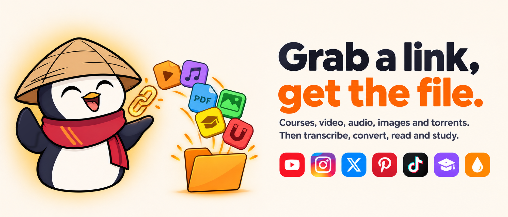
</p>

<h1 align="center">OmniGet</h1>

<p align="center">
  <a href="README.md">English</a>
  · <b>日本語</b>
  · <a href="README_pt_br.md">Português (BR)</a>
  · <a href="README.ru.md">Русский</a>
  · <a href="README_zh_CN.md">简体中文</a>
</p>

<p align="center">
  <b>Udemy や Hotmart の講座、YouTube、Instagram、X、Pinterest、TikTok をはじめ 1,800 以上のサイトからダウンロードできます。<br/>保存したものは、そのまま文字起こし、変換、閲覧、学習に使えます。ターミナル不要の、無料のデスクトップアプリひとつで完結します。</b>
</p>

<p align="center">
  <a href="https://omniget.nav.bd/"></a>
  <a href="https://github.com/OpenSelena/omniget/releases/latest"></a>
  <a href="https://github.com/OpenSelena/omniget/releases"></a>
  <a href="https://github.com/OpenSelena/omniget/stargazers"></a>
  <a href="LICENSE"></a>
  <a href="https://t.me/OpenSelena"></a>
  <a href="https://hosted.weblate.org/engage/omniget-openselena/"></a>
</p>

<p align="center">
  <a href="#ダウンロードとインストール"></a>
  &nbsp;
  <a href="#ツールセクション-25-カテゴリの-158-ツール"></a>
</p>

<p align="center">
  <sub>無料です。GPL-3.0 のオープンソースです。アカウント不要、広告なし、ダウンロード内容のテレメトリーもありません。ファイルはあなたのコンピューターに残ります。</sub>
</p>

<p align="center">
  <br/>
  <sub>本プロジェクトは独立したフォークであり、OmniGet または原作者 Tonho との提携・関係はありません。<br/>
  <a href="https://github.com/igect">igect</a> が GPL-3.0 のもとでメンテナンスしています · <a href="https://github.com/tonhowtf">Tonho</a> によるオリジナルのアーキテクチャに基づいています</sub>
</p>

<p align="center">
  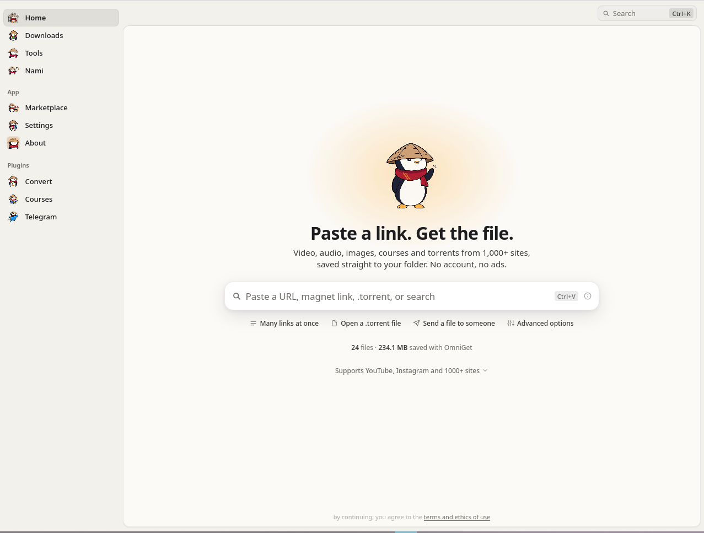
</p>

---

## 目次

- [OmniGet を選ぶ理由](#omniget-を選ぶ理由)
- [ダウンロードとインストール](#ダウンロードとインストール)
- [1 分で最初のダウンロード](#1-分で最初のダウンロード)
- [OmniGet でダウンロードできるもの](#omniget-でダウンロードできるもの)
- [ブラウザ拡張機能の導入手順](#ブラウザ拡張機能の導入手順)
- [ツールセクション: 25 カテゴリの 158 ツール](#ツールセクション-25-カテゴリの-158-ツール)
- [AI エージェント向けの OmniGet: MCP サーバーと Claude Code プラグイン](#ai-エージェント向けの-omniget-mcp-サーバーと-claude-code-プラグイン)
- [プラグイン: Courses、Telegram、Convert](#プラグイン-coursestelegramconvert)
- [その他の機能](#その他の機能)
- [プライバシーと OmniGet がしないこと](#プライバシーと-omniget-がしないこと)
- [コード署名ポリシー](#コード署名ポリシー)
- [よくある質問](#よくある質問)
- [コマンドライン](#コマンドライン)
- [ソースからのビルド](#ソースからのビルド)
- [コントリビュートと翻訳](#コントリビュートと翻訳)

---

## OmniGet を選ぶ理由

講座を購入したら、プラットフォームから削除される前に自分のディスクに保存しておきたいものです。yt-dlp のフラグはどうしても覚えられず、チートシートを手放せません。Instagram のストーリーズ用のサイト、X の動画用の別のサイト、Pinterest 用の Chrome 拡張機能、字幕用の Python スクリプトと使い分けていて、どれもログイン状態を覚えてくれません。

OmniGet は、それらすべてをひとつのテキストボックスにまとめます。リンクを貼り付けて、画質の選択肢付きのプレビューを確認し、ダウンロードをクリックするだけです。同じウィンドウで、講座の再生、PDF の閲覧、音声の文字起こし、Pinterest ボードのバックアップまで行えます。yt-dlp と FFmpeg は自動でインストールされ、常に最新の状態に保たれるので、設定することも、ターミナルを開くこともありません。

<p align="center">
  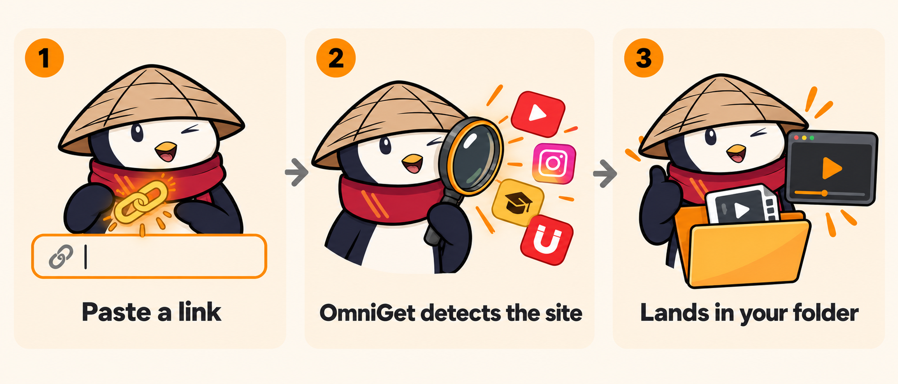
</p>

### 他のツールとの比較

| | OmniGet | yt-dlp 単体 | 単一サイト向けの Web ダウンローダー | 有料の講座ダウンローダー |
|---|---|---|---|---|
| 対応サイト | 講座、Instagram、X、Pinterest、Bilibili、Telegram、トレントにネイティブ対応し、さらに yt-dlp 経由で 1,800 以上 | 1,800 以上 | 1 つ | 1〜2 つのプラットフォーム |
| セットアップ | ファイルを 1 つダウンロードして開くだけ | Python、PATH、FFmpeg、フラグ | 不要 | インストーラー、ライセンスキー |
| ログインが必要なコンテンツ | 拡張機能を通じてブラウザの Cookie を利用 | `--cookies` で手動エクスポート | ほぼ非対応 | 場合による |
| キュー | 再開、バックオフ付きリトライ、ルール、フォロー中のチャンネル | 一度に 1 コマンド | なし | 製品による |
| ダウンロード後 | プレイヤー、リーダー、フラッシュカード、ノート、158 のツール | ファイル | ファイル（再エンコードされることが多い） | ファイル |
| 価格とライセンス | 無料、GPL-3.0 | 無料、Unlicense | 無料（広告あり） | サブスクリプション |

yt-dlp は OmniGet を動かしているエンジンであり、yt-dlp がなければ OmniGet は存在しませんでした。普段からターミナルを使っていて、ファイルだけが欲しいのであれば、yt-dlp 単体が適したツールです。

---

## ダウンロードとインストール

お使いのシステムを選んでください。すべてのビルドは [Releases ページ](https://github.com/OpenSelena/omniget/releases/latest) で公開されています。アップデートはアプリ内で届きます。

<table>
  <tr>
    <th align="left">システム</th>
    <th align="left">ダウンロードするもの</th>
    <th align="left">その他の方法</th>
  </tr>
  <tr>
    <td><b>Windows 10 / 11</b></td>
    <td><code>omniget_x.y.z_x64-setup.exe</code>（インストーラー）<br/><code>omniget_x.y.z_x64-portable.exe</code>（インストール不要、どこからでも実行可能）<br/><code>omniget_x.y.z_x64_en-US.msi</code>（IT 部門での展開用）</td>
    <td><code>winget install -e --id OpenSelena.OmniGet</code></td>
  </tr>
  <tr>
    <td><b>macOS 10.15+</b></td>
    <td>Apple Silicon（M1 以降）向けの <code>omniget_x.y.z_aarch64.dmg</code><br/>Intel Mac 向けの <code>omniget_x.y.z_x64.dmg</code></td>
    <td><code>brew install --cask OpenSelena/tap/omniget</code></td>
  </tr>
  <tr>
    <td><b>Linux</b></td>
    <td>Debian と Ubuntu 向けの <code>.deb</code>（amd64 と arm64）<br/>Fedora、openSUSE、RHEL 系向けの <code>.rpm</code>（x86_64 と aarch64）<br/>それ以外向けの <code>.AppImage</code>（amd64 と aarch64）</td>
    <td>AppImage は <code>.zsync</code> ファイルを通じて自動更新されます</td>
  </tr>
</table>

### 初回起動時の警告と、その解除方法

OmniGet は有料の証明書で署名されていないため、どのシステムでも初回起動時に警告が表示されます。これはオープンソースのデスクトップアプリではよくあることで、対処は一度だけで済みます。

**Windows.** SmartScreen の青いボックスが表示されます。**詳細情報** をクリックし、**実行** をクリックしてください。

**macOS.** Gatekeeper がアプリを開くのを拒否し、「壊れている」と表示されることがあります。OmniGet をアプリケーションフォルダーにドラッグしたあと、ターミナルを開き（Spotlight で「ターミナル」と入力）、次の 2 行を貼り付けてください：

```bash
xattr -cr /Applications/omniget.app
codesign --force --deep --sign - /Applications/omniget.app
```

その後、いつもどおり Launchpad から OmniGet を開いてください。

**Linux（Debian 12 以降または Ubuntu 24.04 以降での AppImage）.** これらのリリースには、AppImage に必要な FUSE 2 が含まれていません。libfuse のエラーでファイルが起動しない場合は、`sudo apt install libfuse2` を実行するか、`./omniget.AppImage --appimage-extract-and-run` で起動してください。`.deb` ならこの問題は起きません。

### Linux のメディアプラグイン

OmniGet は WebKitGTK でウィンドウを描画しており、WebKitGTK はすべての `<video>` と `<audio>` を GStreamer で再生します。GStreamer のプラグインが不足していると、WebKitGTK はメディアの再生を静かに失敗させるのではなく、プレイヤーが表示された瞬間に自身の Web プロセスを中断してしまい、空のウィンドウだけが残ります。ほとんどのデスクトップディストリビューションには、すでにこれらのプラグインが入っています。Arch や最小構成のサーバーイメージではオプション扱いなので、一度インストールしておいてください：

```bash
sudo apt install gstreamer1.0-plugins-good gstreamer1.0-plugins-bad gstreamer1.0-libav   # Debian, Ubuntu
sudo dnf install gstreamer1-plugins-good gstreamer1-plugins-bad-free gstreamer1-plugin-libav   # Fedora
sudo pacman -S gst-plugins-good gst-plugins-bad gst-libav   # Arch
```

クラッシュを防ぐのは `gstreamer1.0-plugins-good`（`gst-plugins-good`）です。WebKitGTK が必要とするオーディオシンクがここに含まれているためです。残りの 2 つには H.264 と AAC のデコーダーが含まれているので、これらがないとプレイヤーは開いても無音または黒い画面のままになります。`.deb` と `.rpm` は 3 つすべてを依存関係として要求するので、この問題が起きるのは AppImage か手動でビルドしたパッケージの場合だけです。

### ポータブルモード

Windows の `.exe` と同じ場所に `portable.txt`（または `.portable`）という名前の空ファイルを作成し、再起動してください。設定、データベース、Cookie、プラグイン、キャッシュ、yt-dlp、FFmpeg がすべて実行ファイルの隣にある `data` フォルダーに移動します。`AppData` には一切触れないので、インストール全体を USB メモリに収められます。

---

## 1 分で最初のダウンロード

1. OmniGet を開きます。セットアップ画面で言語とテーマを選ぶと、ワンクリックで yt-dlp と FFmpeg がインストールされます。yt-dlp は実行前に SHA-256 で検証されます。
2. 任意のリンクをコピーします：YouTube の動画、Instagram のリール、X の投稿、Pinterest のボード、マグネットリンク、ファイルへの直接の URL など。
3. ホーム画面のボックスに貼り付けます。OmniGet がサイトを判別し、タイトル、サムネイル、選択可能な画質を表示します。1 つ選んで Enter キーを押してください。

ダウンロードページには、ダウンローダーから直接読み取った速度、フェーズ、残り時間が表示されるので、止まったダウンロードは「残り 3 秒」で固まって見えるのではなく、止まっているとわかるように表示されます。中断されたダウンロードは、止まったところから再開されます。レート制限のあるサイトではバックオフ付きでリトライし、サイトごとの接続数も自動で調整されるため、YouTube では最大 16 の並列フラグメントを使い、429 を返すサイトでは接続数を減らします。Python 3.10 以降がある場合、yt-dlp はその Python 上で zipapp として動作し、起動のたびに同梱のバイナリを展開する代わりに 1 秒未満で起動します。

<p align="center">
  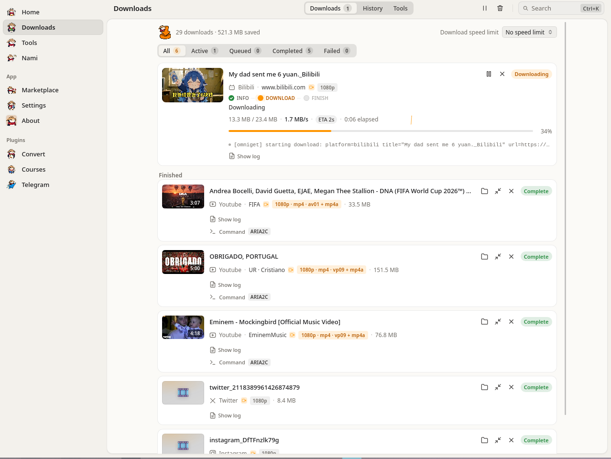
</p>

### ウィンドウを開かずに済ませる

システム上のどこかでリンクをコピーし、**Ctrl+Shift+D**（macOS では **Cmd+Shift+D**）を押してください。OmniGet がクリップボードを読み取り、バックグラウンドでダウンロードを開始します。2 つ目のホットキー **Ctrl+Shift+M** は音声のみを取得するので、何も開かずに YouTube のリンクを MP3 にできます。この機能は有効にするまでオフになっており、どちらのショートカットも **Settings → Downloads → Clipboard & hotkeys** で割り当てを変更できます。

---

## OmniGet でダウンロードできるもの

OmniGet は、よく使われるプラットフォーム向けのネイティブのエクストラクターを備えており、それ以外はすべて、約 1,800 のサイトに対応する [yt-dlp](https://github.com/yt-dlp/yt-dlp) に任せます。

| カテゴリ | サイトと形式 |
|---|---|
|  オンライン講座 | 組み込みの Courses プラグインを通じて 38 のプラットフォーム（Hotmart、Udemy、Kiwify、Rocketseat、Coursera、Domestika、Skillshare など）に対応しています。すべてのレッスン、セクションの選択、添付ファイル、中断したところからの再開に対応しています。 |
|  動画と音声 | YouTube（動画、プレイリスト、チャンネル、ライブの最初から、チャプター、SponsorBlock）、Instagram、TikTok、X/Twitter、Reddit、Twitch（VOD、クリップ、ライブ）、Vimeo、Bluesky、Threads、Pinterest、Douyin |
|  Bilibili（ログイン時） | ご利用のサブスクリプションに応じて 4K、HDR、Dolby Vision、Hi-Res ロスレス、Dolby Atmos に対応。弾幕コメントを XML、ASS、JSON で保存、Kodi や Jellyfin 向けの NFO ファイル、カスタムの命名テンプレート、番組、講座、お気に入り、後で見る、履歴を含む 11 種類の URL に対応 |
|  画像ギャラリー | gallery-dl を通じて 250 以上のサイト（DeviantArt、Pixiv、ArtStation、Flickr、Tumblr、Imgur、Kemono など）からギャラリーやプロフィールを丸ごと取得 |
|  一括 | 多数のリンクを貼り付けるか `.txt` を読み込み、サブレディット全体、Reddit や X のプロフィール、Instagram や Pinterest のプロフィール、Facebook のアルバムをダウンロード |
|  ファイルと転送 | 内蔵の BitTorrent クライアントによる `.torrent` ファイルとマグネットリンク、HTTP による直接のファイル、HLS と DASH のマニフェスト、短い単語コードを使った 2 つの OmniGet 間での個人間転送 |
|  Telegram | 組み込みの Telegram プラグインを通じて、参加しているチャンネルやグループの写真、動画、ファイル、音声を、チャンネルごとに整理されたフォルダー（`OmniGram/<channel>/`）に保存 |

一度設定すれば忘れてよいオプション：デフォルトの画質、音声のみの形式（MP3、M4A、Opus、FLAC、WAV）、字幕の言語と形式（SRT、VTT、ASS、埋め込みまたは別ファイル）、サムネイルとメタデータの埋め込み、ファイル名のテンプレート、プラットフォームごとの整理、既存ファイルのスキップ、チャプターごとの分割、速度制限、同時ダウンロード数、プロキシ。ルールを使えば、特定のチャンネルやホストを、毎回確認することなく、指定したフォルダーと画質に振り分けられます。フォロー中のチャンネルはバックグラウンドでチェックされ、新しいアップロードをトレイ通知付きで自動的にダウンロードすることもできます。

<p align="center">
  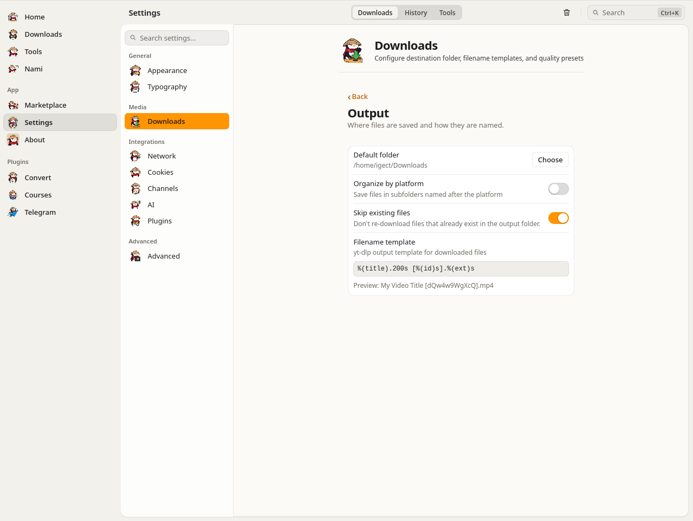
</p>

---

## ブラウザ拡張機能の導入手順

拡張機能には 2 つの役割があります。認識できるサイト（YouTube、Instagram、TikTok、X、Reddit、Twitch、Pinterest、Bluesky、Telegram、Vimeo、Udemy、Hotmart、Rocketseat、Bilibili、SoundCloud）では、ワンクリックまたは **Alt+O** でページを OmniGet に送ります。それ以外のサイトでは、ネットワーク通信を監視して MP4、HLS、DASH、WebM、音声のストリームを見つけ、ポップアップに一覧表示します。どちらの場合も Cookie とリファラーを転送するので、Instagram のストーリーズ、有料の講座、メンバー限定の動画など、ログインしている非公開のコンテンツも OmniGet でダウンロードできます。Cookie は実際のサイトごとにまとめられるため、ブラジルの `.com.br` ドメインは、ほかのすべての `.com.br` サイトと 1 つのエントリーを共有するのではなく、独自のエントリーを持ちます。ポップアップには YouTube 用の **Force H.264** スイッチもあり、VP9 や AV1 でカクつくコンピューターに便利です。

スニッファーが検出できないサイトのために、**Deep search** があります。これはポップアップにあるスイッチで、ページ自体の動画プレイヤーにフックし、ネットワークリクエストとして現れないプレイリストも捕捉します。初回にすべてのサイトへのアクセス許可を求め、それまではオフのままです。さらにスニッファーは、ダウンロード前に HLS ストリームのサイズを見積もり、サイトが別々に配信する動画トラックと音声トラックを組み合わせて 1 つのファイルにし、見つけたものの先頭のバイトをチェックして HTML のエラーページが動画として保存されないようにし、オプションページで取得ルールを編集できるようにします。同じオプションページでは、Chrome が Manifest V2 拡張機能のサポートを終了する前に、インストール済みの拡張機能の一覧をバックアップすることもできます。これにはオプションの「management」権限が必要で、使うときにだけ許可を求めます。

慣れ具合に合わせて、レベルを選んでください。

<p align="center">
  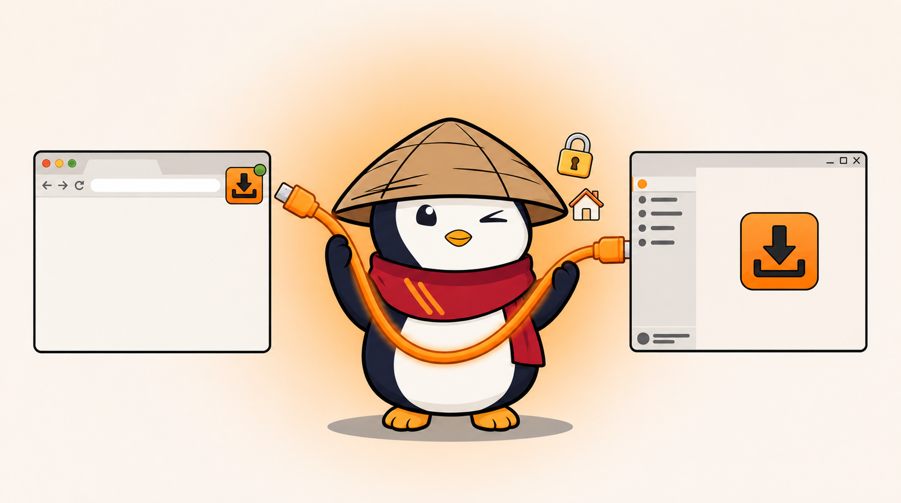
</p>

### レベル 1: アプリ内から（ダウンロードも zip ファイルも不要）

1. まだであれば OmniGet をインストールし、一度起動します。
2. **Settings → Plugins → Browser extension** に移動します。Chrome の横にある **Update / Install** をクリックします。OmniGet に同梱されている拡張機能がフォルダーにコピーされ、そのフォルダーが開きます。
3. Chrome を開き（Edge、Brave などの Chromium 系ブラウザでも同じ手順です）、アドレスバーに `chrome://extensions` と入力します。
4. 右上のスイッチで **デベロッパー モード** をオンにします。
5. **パッケージ化されていない拡張機能を読み込む** をクリックし、OmniGet が開いたフォルダーを選択します。
6. ツールバーに OmniGet のアイコンが表示されます。オプションページが自動で開き、アプリを探していると表示されます。
7. OmniGet に戻り、**Settings → Plugins → Browser extension** のまま **Pair extension** をクリックします。数秒以内にアプリに「Extension connected」と表示され、オプションページが緑色になります。これで完了です。

以降は、対応しているページを開いてアイコンをクリックするだけです。ページ、その Cookie、タイトルが OmniGet に送られ、ダウンロードが始まります。Cookie は **Settings → Cookies** にも表示され、Courses プラグインや Instagram、X、Pinterest のツールで再利用されます。

### レベル 2: リリースの zip から

すべてのリリースには `omniget-chrome-extension-vX.Y.Z.zip` が含まれています。[最新のリリース](https://github.com/OpenSelena/omniget/releases/latest) からダウンロードして展開し、上記の手順 3〜7 に従って、**パッケージ化されていない拡張機能を読み込む** で展開したフォルダーを指定してください。アプリとブラウザを別々のマシンで使っている場合や、ほかの人のためにインストールする場合はこの方法を使ってください。

### レベル 3: Firefox、その他のブラウザ、手動ペアリング

Firefox：Firefox の横にある **Settings → Plugins → Browser extension → Update / Install** をクリックし、`about:debugging#/runtime/this-firefox` を開いて **一時的なアドオンを読み込む** をクリックし、エクスポートされたフォルダー内の `manifest.json` を選択します。Firefox は再起動時に一時的なアドオンを削除するので、拡張機能が AMO で公開されるまでは、この手順を繰り返してください。Safari の拡張機能は App Store を通じて配布する必要があるため、Safari にはまだ対応していません。

手動ペアリング：**Pair extension** がタイムアウトした場合は、拡張機能のオプションページを開き（アイコンを右クリック → オプション）、OmniGet で **Pairing token** を表示してコピーし、オプションページに貼り付けてください。エンドポイントの URL は自動で検出されます。アプリは `127.0.0.1` のポート 47720〜47729 で待ち受けており、トークンはインストールごとに生成されるので、何もあなたのマシンの外には出ません。

拡張機能がインストールされていても OmniGet が閉じている場合、クリックは `omniget://` リンクスキームにフォールバックします。この場合も URL はキューに追加されますが、Cookie は渡せません。Chrome に初めて確認されたときに「常に許可」にチェックを入れてください。

---

## ツールセクション: 25 カテゴリの 158 ツール

ツールは、OmniGet がダウンロードの枠を超えて成長した部分です。各タイルは 1 つの仕事を担う独立した Rust コマンドで、JSON を受け取って JSON を返します。これにより、内蔵の MCP サーバーを通じて AI エージェントがツールを操作することもできます。ハブには、英語とポルトガル語を理解する検索ボックス（「legenda」で字幕ツールが見つかります）とプラットフォームフィルターがあり、Windows でしか動かないツールはタイルにその旨が表示され、ほかの OS では非表示になります。以下のツールはすべてあなたのマシン上で動作します。ネットワークにアクセスするのは、名前のとおりのサイトからデータを取得するツールだけです。

<p align="center">
  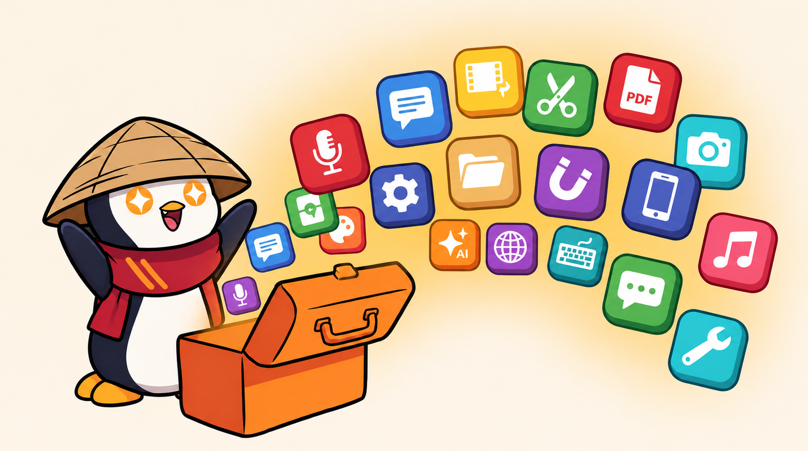
</p>

<p align="center">
  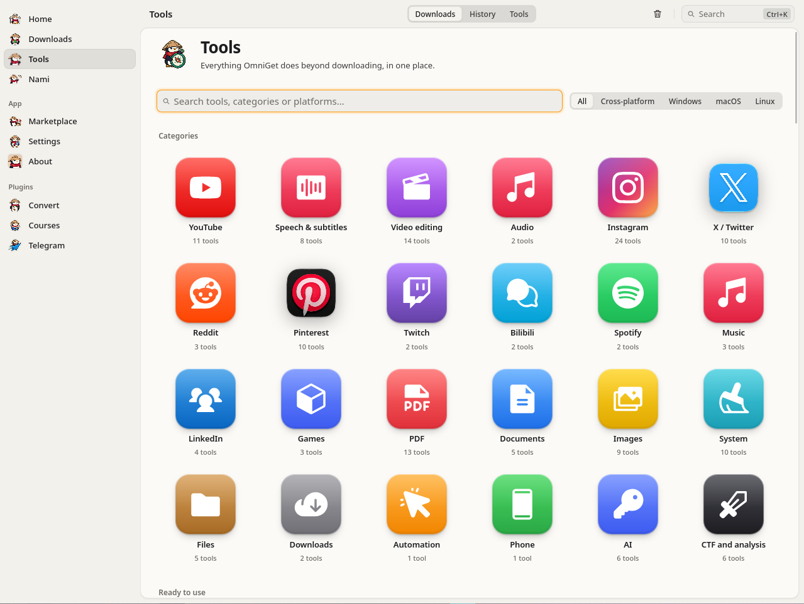
</p>

ステータスの凡例：印がないものは利用可能、**beta** は動作するもののすべてのアカウント種別ではテストされていないもの、**planned** は今後の方向性がわかるようにタイルだけが存在し、まだ何もしないものを表します。

<table>
  <tr>
    <td>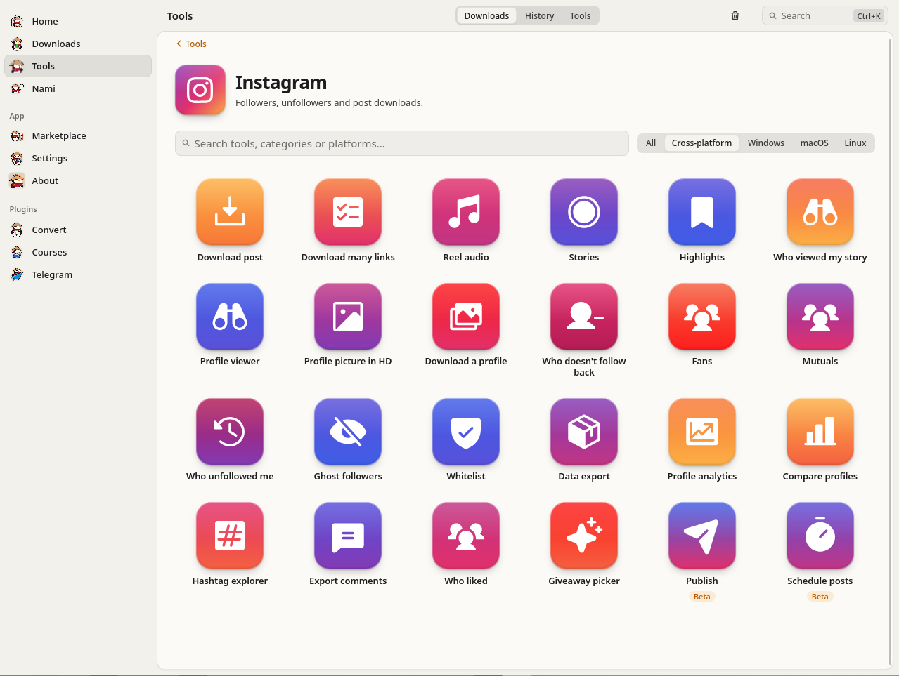</td>
    <td>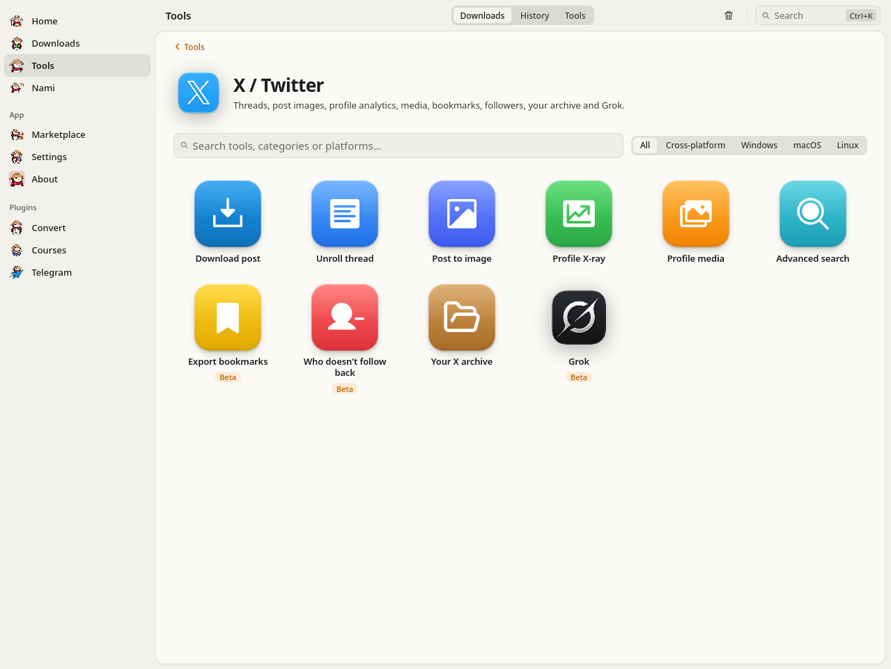</td>
  </tr>
  <tr>
    <td>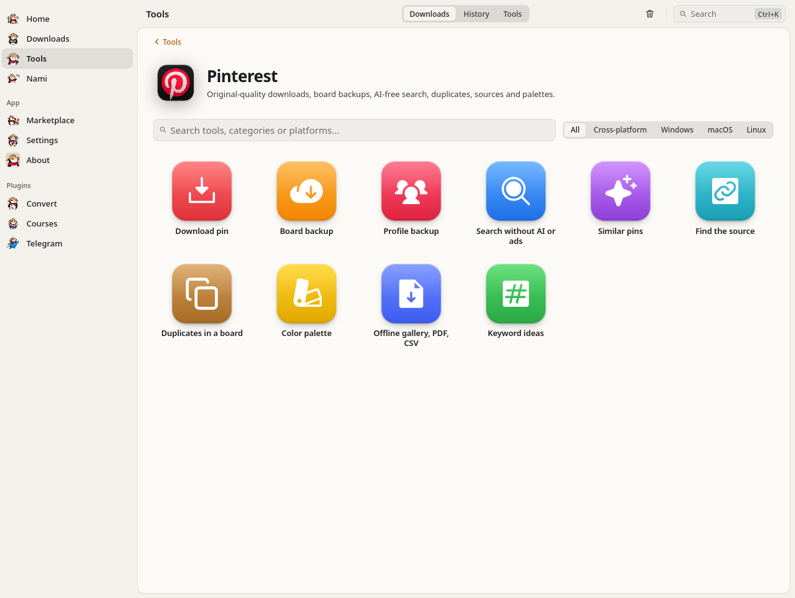</td>
    <td>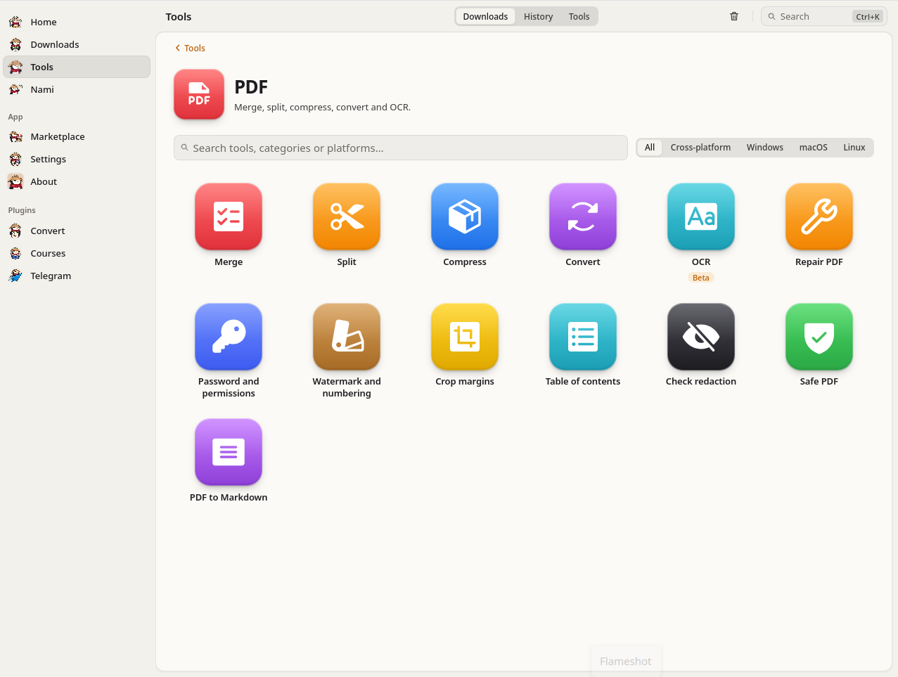</td>
  </tr>
  <tr>
    <td>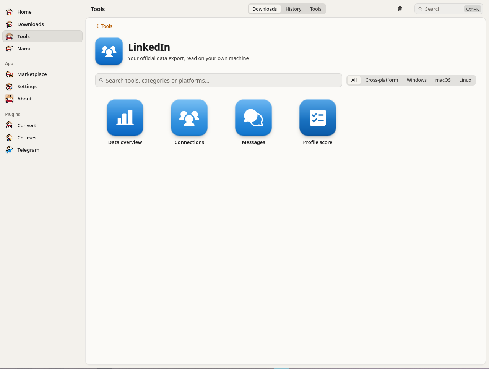</td>
    <td>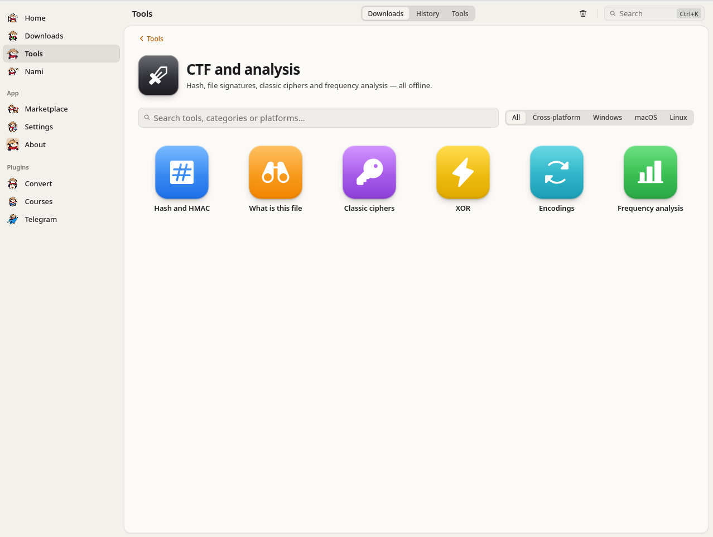</td>
  </tr>
</table>

###  YouTube (11)

- **動画のダウンロード。** リンクを貼り付けて、画質、形式、字幕を選びます。ホーム画面と同じエンジンです。
- **メタデータ。** 動画なしで、情報、説明文、サムネイルを保存します。
- **サムネイル。** すべてのカバー画像を閲覧し、任意の解像度で保存します。
- **字幕。** 字幕をダウンロードするか、2 つの言語を 1 つのバイリンガルファイルに結合します。
- **コメントとチャプター。** コメントやチャプターマーカーを取得し、絞り込んで、JSON または CSV でエクスポートします。
- **ライブチャット。** 配信のチャットのリプレイを JSON または CSV で保存します。
- **字幕ワークショップ。** 波形表示、2 点同期、検索と置換、自動修正、AI による文法チェックと翻訳を使って、SRT、VTT、ASS ファイルを編集、翻訳、タイミング調整します。
- **SponsorBlock.** スポンサー、イントロ、アウトロの区間を確認し、それらをスキップするための yt-dlp のフラグを取得します。
- **低評価。** Return YouTube Dislike から、高評価数、低評価数、評価を取得します。
- **本当のサムネイル。** 釣り目的のカバー画像ではなく、CDN がすでに持っている 25%、50%、75% 地点のフレームを表示します。
- **Force H.264.** ブラウザ拡張機能のスイッチで、YouTube を VP9 や AV1 ではなく H.264 で再生させます。新しいコーデックでカクつくマシン向けです。

###  音声と字幕 (8)

- **文字起こし。** whisper.cpp を使って、音声や動画をオフラインで字幕にします。モデルは必要に応じてダウンロードされ、macOS では Metal によるアクセラレーションが使われます。
- **テキスト読み上げ。** Microsoft Edge の自然な音声を無料で使い、同期した字幕ファイルも作成します。
- **字幕の翻訳。** タイミングを保ったまま、お使いの AI プロバイダーまたは LibreTranslate サーバーで SRT を翻訳します。
- **字幕からの吹き替え。** SRT を各行に合わせた音声トラックに変換し、必要に応じて動画の音声を置き換えます。*beta*
- マシン上で動作する VoiceStudio を通じて、**声のクローン**、**声のデザイン**、**ボーカルの分離** が行えます。*beta*
- **音声入力。** グローバルショートカットを押して話すと、whisper がカーソルの位置にテキストを入力します。*beta*

###  動画編集 (14)

- **クリップの切り出し。** ディスク上の動画を選んで、一部分を切り出します。結果はダウンロードキューに追加されます。
- **変換。** Convert プラグインを通じて、コンテナ、コーデック、解像度を変更したり、圧縮したりします。
- **サイズを指定して圧縮。** 2 パスエンコードで、Discord 向けの 10 MB やメール向けの 25 MB など、目標のサイズにぴったり合わせます。
- **動画から GIF へ。** クリップを GIF またはアニメーション WebP にします。濁って見えないパレットを使います。
- **無音のカット。** 録画の中の無音部分を見つけ、映像と音声の両方からまとめてカットします。
- **字幕の変換。** SRT、VTT、ASS を相互に変換するか、映像に焼き込みます。
- **字幕の再同期。** 遅れている、早すぎる、徐々にずれる字幕を、ずらしたり、別のフレームレートに合わせて伸縮したり、2 つのアンカーで修正したりします。
- **動画の修復。** FFmpeg にすでにあるフィルターで、ちらつき、粒状ノイズ、バンディングを取り除きます。
- **動画の手ぶれ補正。** 2 パスの vidstab で、クリップ全体の揺れを計測してから打ち消します。
- **写真からステッカーへ。** 写真やクリップを、サイズ制限にきちんと収まる WhatsApp や Telegram のステッカーにします。
- **自動キャプション** と **テキスト読み上げ** は、上記の音声ツールを開きます。
- **画面の録画。** FFmpeg を通じて画面とシステム音声を録画し、直前の出来事を保存できるリプレイバッファーも備えています。*beta*
- **タイムラインエディター。** *planned*

###  オーディオ (2)

- **ラウドネスの正規化。** 2 パスの EBU R128 で、ストリーミング、ポッドキャスト、放送が求める音量に合わせます。
- **ノイズ除去。** 録音からヒスノイズ、ファンの音、室内の雑音を取り除きます。追加のダウンロードは不要です。

###  Instagram (24)

これらはすべて、ブラウザ拡張機能で取得したあなた自身の Instagram セッションで動作するので、ストーリーズ、親しい友達、自分のリストも扱えます。読み取りはペースを抑えて行われ、書き込み操作はレート制限の兆候が最初に現れた時点で停止します。

- **投稿のダウンロード。** リンクから写真、動画、リール、IGTV、カルーセルを最高画質でダウンロードします。
- **複数のリンクをダウンロード。** リストか `.txt` を貼り付けて、すべてを取得します。
- **リールの音声。** 音声だけを M4A または MP3 で保存します。
- **ストーリーズ。** 親しい友達向けのものも含め、既読にせずにストーリーズをダウンロードします。
- **ハイライト。** プロフィールのハイライトを 1 つ、またはすべてダウンロードします。
- **ストーリーを見た人。** 公開中の各ストーリーの閲覧者を一覧表示してエクスポートします。
- **プロフィールビューアー。** 自己紹介、各種カウント、HD の写真、そのアカウントがあなたをフォローしているかどうかを表示します。
- **HD のプロフィール写真。**
- **プロフィールのダウンロード。** すべての投稿、リール、タグ付けされた投稿、保存済みの投稿を、指定した上限までダウンロードします。
- **フォローを返さない人。** フォロワーとフォロー中を比較し、ホワイトリストでアカウントを保護しながら、安全なペースでフォローを解除します。
- **ファン。** あなたをフォローしているものの、あなたはフォローを返していないアカウントです。削除することもできます。
- **相互フォロー。**
- **フォローを外した人。** リストのスナップショットを時系列で比べ、誰が去り、誰が来たかを表示します。
- **幽霊フォロワー。** いいねもコメントもしないフォロワーと、最もよく反応してくれるフォロワーを表示します。
- **ホワイトリスト。** フォロー解除の候補に決して挙がらないアカウントです。
- **データエクスポート。** Meta の「情報をダウンロード」の zip をオフラインで読み込みます：保留中のリクエスト、親しい友達、ブロック中のアカウントなど。
- **プロフィール分析。** 任意の公開プロフィールについて、エンゲージメント率、投稿頻度、最適な曜日と時間帯、ハッシュタグ、人気の投稿を表示します。
- **プロフィールの比較。** 最大 6 つのプロフィールを並べて比較します。
- **ハッシュタグエクスプローラー。** 投稿数、最近の投稿と人気の投稿、関連するハッシュタグを表示し、ダウンロードできます。
- **コメントのエクスポート。** 投稿のすべてのコメントを、フィルター付きで CSV にエクスポートします。
- **いいねした人。** 投稿にいいねしたアカウントを一覧表示してエクスポートします。
- **プレゼント抽選。** メンション、キーワード、1 人 1 回などのルールを設定して、コメントの中から当選者を抽選します。
- **投稿。** あなたのセッションまたは公式の Graph API を通じて、写真、カルーセル、リール、動画、ストーリーを投稿します。*beta*
- **予約投稿。** 日時を指定して投稿をキューに入れます。OmniGet が起動している間に投稿されます。*beta*

###  X / Twitter (10)

公開データはログインなしで FxTwitter API から取得します。非公開のもの（ブックマーク、あなたのフォロー、X 上の Grok）には、Cookie マネージャーにあるあなたの X セッションを使います。

- **投稿のダウンロード。** 任意の投稿から動画、画像、GIF をダウンロードします。
- **スレッドの展開。** スレッド全体を 1 ページにまとめ、Markdown、HTML、テキストでエクスポートします。
- **投稿の画像化。** どこでも共有できる、投稿のきれいな PNG カードを作成します。
- **プロフィール X 線。** 任意のアカウントのエンゲージメント、投稿に最適な時間帯、人気の投稿、ハッシュタグを表示します。
- **プロフィールのメディア。** プロフィールのすべての写真と動画を、オリジナルの画質で一度に取得します。
- **高度な検索。** X の演算子を使ってクエリを組み立て、トレンドを確認し、結果をエクスポートします。
- **ブックマークのエクスポート。** フォルダーを含むすべてのブックマークを、JSON、CSV、Markdown、HTML にエクスポートします。*beta*
- **フォローを返さない人。** フォロー中とフォロワーを照合し、ホワイトリストを使って安全にフォローを解除します。*beta*
- **X のアーカイブ。** データの zip をオフラインで開きます：統計、人気の投稿、いいね、フォローのリスト。
- **Grok.** xAI API またはあなたの X セッションを通じて、X のライブ検索付きで Grok に質問したり、スレッドを要約したりします。*beta*

###  Facebook (2)

- **アルバムのダウンロード。** アルバムのリンクを貼り付けると、その中のすべての写真と動画が 1 つのフォルダーに保存されます。
- **動画のダウンロード。** 単一の動画やリールを、リンクボックスから直接ダウンロードします。

###  Reddit (3)

- **投稿のダウンロード。** v.redd.it の音声付き動画、ギャラリー、単一の画像、外部リンクをダウンロードします。
- **スレッドのアーカイブ。** 投稿とすべてのコメントを、まだ残っているうちに Markdown、閲覧可能な HTML ページ、生の JSON で保存します。
- **データエクスポートの閲覧。** Reddit の公式データの zip を、実際に読める要約に変換します。

###  Pinterest (10)

公開されているものはログインなしで利用できます。Cookie が必要なのは、シークレットボードと保存の取り消しの場合だけです。

- **ピンのダウンロード。** 画像はオリジナルの画質で、動画は MP4 で、GIF、カルーセル、ストーリーのページもダウンロードします。
- **ボードのバックアップ。** ボードまたはセクションのすべてのピンを、オリジナル画像、動画、CSV/JSON とともに保存し、差分同期にも対応します。
- **プロフィールのバックアップ。** プロフィールのすべての公開ボードを、ボードごとに 1 つのフォルダーで保存し、作成したピンも保存します。
- **AI や広告なしの検索。** AI 画像、プロモーションピン、動画を非表示にするフィルターをかけてから、ダウンロードします。
- **似ているピン。** 任意のピンの「その他のおすすめ」を、絞り込んでダウンロードできます。
- **出典の検索。** リンク先、作成者、リンク切れのチェック、Wayback Machine、画像の逆検索を行います。
- **ボード内の重複。** 同一のピンやほぼ同一のピンを見つけ、必要に応じて保存を取り消します。
- **カラーパレット。** ボードやピンのパレットを、16 進数、CSS、JSON で取得します。
- **オフラインギャラリー、PDF、CSV。** ボードを検索可能な HTML ギャラリー、PDF のムードボード、スプレッドシートにします。
- **キーワードのアイデア。** 検索候補、絞り込み、人気のピンで使われている単語を表示します。

###  Twitch (2)

- **エモートパック。** チャンネルのすべてのエモートとバッジを、Twitch、BTTV、FFZ、7TV から取得し、提供元ごとに整理します。
- **VOD のチャット。** VOD やクリップのチャットのリプレイ全体を JSON、CSV、字幕で保存し、最も盛り上がった時間に印を付けます。

###  Bilibili (2)

Bilibili の動画のダウンロードはホーム画面から行います。この 2 つは、画面上を流れるコメントに関するツールです。

- **弾幕のエクスポート。** 動画をダウンロードせずに、その弾幕を XML、ASS、JSON で保存します。
- **弾幕の焼き込み。** ローカルのクリップにコメントのトラックを描き込み、共有できる MP4 を作成します。

###  Spotify (2)

- **テーマとカラー。** Spicetify のテーマで Spotify クライアントをカスタマイズします。*beta*
- **拡張機能。** Spicetify の Marketplace から拡張機能やカスタムアプリをインストールします。*beta*

###  音楽 (3)

- **プレイリストから M3U へ。** エクスポートしたプレイリストを手持ちの音声ファイルと照合し、任意のローカルプレイヤー向けに `.m3u8` と `.pls` を書き出します。
- **同期歌詞。** LRCLIB から歌詞を取得し、各トラックの隣に `.lrc` を保存します。
- **Spotify の履歴。** 完全なデータエクスポートを開き、Wrapped では表示されないすべてを確認します。

###  LinkedIn (4)

4 つとも、LinkedIn にリクエストできる公式のデータエクスポートを、あなたのマシン上で読み取ります。ログインは一切行いません。

- **データの概要。** つながり、メッセージ、投稿、そして広告主があなたについて知っていること。
- **つながり。** つながりのリストを絞り込み、グループ化し、エクスポートします。
- **メッセージ。** チャット履歴を閲覧し、ローカルのページとして保存します。
- **プロフィールスコア。** オフラインでプロフィールの充実度をチェックし、足りないものを表示します。

###  ゲーム (3)

- **Switch のアルバム。** Switch の SD カードからスクリーンショットとクリップを取り込み、ゲーム名と日付で名前を付けます。
- **クリップの整理。** Game Bar、ShadowPlay、OBS、Steam のキャプチャを、ゲームごとのフォルダーに振り分けます。
- **Linux で動く？** 1 つのゲーム、または Steam ライブラリ全体の ProtonDB のティアを表示します。

###  PDF (13)

- **結合。** 複数の PDF を、選んだ順序で 1 つにまとめます。
- **分割。** ページを抽出するか、PDF を複数に分割します。
- **圧縮。** 読みやすさを保ちながら PDF を小さくします。
- **変換。** PDF を画像や Word に変換し、その逆も行います。
- **OCR.** スキャンした PDF を検索可能にします。*beta*
- **修復。** 壊れた相互参照テーブル、途中で切れたダウンロード、ヘッダーの前のゴミデータなど、開けないファイルを再構築します。
- **パスワードと権限。** AES-128 で PDF をロックするか、すでに開ける PDF のパスワードを外します。
- **透かしと番号付け。** すべてのページにテキストを押印するか、ファイリング用にまとめてベイツ番号を付けます。
- **余白のトリミング。** 白い余白をカットして、テキストが電子書籍リーダーの画面いっぱいに表示されるようにします。余白は自動で検出するか、手動で設定します。
- **目次。** PDF にあるしおりを読み取るか、しおりのない PDF にきちんとしたアウトラインを付けます。
- **墨消しのチェック。** 黒いバーの下にまだファイル内に残っているテキストを見つけ、読み上げて知らせます。
- **安全な PDF。** PDF をピクセルから再構築し、スクリプトやフォームを取り除きます。
- **PDF から Markdown へ。** 見出し、リスト、表を含むきれいな Markdown にし、そのまま LLM に貼り付けられるようにします。

###  ドキュメント (5)

- **SlideShare から PDF へ。** すべてのスライドを最大サイズで取得し、1 つの PDF にまとめます。
- **Google ドキュメントのエクスポート。** 公開されている Docs、Slides、Sheets を PDF、DOCX、PPTX、XLSX で保存します。
- **Calameo のページ。** Calameo の出版物のページを SVG または JPG で保存します。*beta*
- **画像ギャラリー。** gallery-dl を使って、250 以上のサイトからギャラリーやプロフィールを丸ごと取得します。
- **Scribd.** あなた自身のセッションを使って、閲覧可能な書籍を PDF で保存します。*planned*

###  画像 (9)

- **アップスケール。** 任意の Vulkan GPU 上の Real-ESRGAN で、2 倍、3 倍、4 倍に拡大します。*beta*
- **画像のリサイズ。** 幅、高さ、フィット、パーセントで一括リサイズし、必要に応じて形式も変換します。
- **サイズを指定して圧縮。** 収まる範囲で最高の画質を探して KB 単位の目標に合わせ、収まらない場合はそう知らせます。
- **メタデータと GPS。** 写真に含まれる位置情報、カメラ、シリアル番号を確認し、ピクセルに触れずに削除します。
- **重複した写真。** バイト単位で同一のコピーだけでなく、二重に保存された、再圧縮された、リサイズされた、トリミングされた同じ写真を見つけます。
- **スクリーンショットの結合。** スクロールして撮ったスクリーンショットを、重なる部分を繰り返さずに 1 枚の長い画像に結合します。
- **アイコンパック。** 1 枚の画像から `favicon.ico`、Web 用の PNG、`apple-touch-icon`、macOS の `.icns` を作成します。
- **スプライトシート。** シートをフレームに切り分ける、フレームをアトラス付きでシートにまとめ直す、フォルダー内の画像をルールに従ってリサイズする、のいずれかを行います。
- **OCR.** 画像やスライドからテキストをコピーします。*beta*

###  システム (10、Windows 専用の項目は明記)

- **キャッシュのクリーンアップ。** OS ごとのルールで、一時ファイル、ログ、アプリのキャッシュを削除します。削除の前に一覧を確認できます。
- **ディスクアナライザー。** 容量を占めているものをツリーマップと最大のファイルの一覧で表示し、ゴミ箱に送るボタンも備えています。
- **hosts による広告ブロック。** 広告やテレメトリーのドメインを無効な宛先に向けます。専用のブロック内で行うので、あなた自身が書いた行には一切触れません。
- **スタートアップマネージャー。** システムと一緒に起動するものを確認し、項目をオフにします。*beta*
- **アンインストーラー。** アプリと、そのアプリが残していく残骸を削除します。*beta*
- **プライバシーシールド。** Windows のテレメトリー、広告 ID、トラッキングの設定を管理します。Windows。*beta*
- **Windows の強化。** hardentools のマクロ、AutoRun、スクリプトホスト、UAC、Defender の設定を、元に戻せる形で適用します。Windows。*beta*
- **Windows のデブロート。** プリインストールされた Store アプリを削除します。Windows。*beta*
- **レジストリクリーナー。** 孤立したエントリーを、削除前に `.reg` でバックアップしてから削除します。Windows。*beta*
- **ソフトウェアアップデーター。** winget、Chocolatey、Scoop を通じて、プログラムを一括で更新します。Windows。*beta*

###  ファイル (5)

- **重複。** ハッシュで同一のファイルを見つけ、安全に空き容量を確保します。
- **一括リネーム。** 正規表現、連番、大文字・小文字の変換を、適用前のプレビュー付きで行います。
- **完全削除。** 削除する前にファイルを上書きし、復元ツールで何も見つからないようにします。
- **ファイル検索。** Windows では Everything、macOS では Spotlight、Linux では fd を使って瞬時に検索します。
- **スリープ防止。** 長い処理の間、コンピューターがスリープしないようにします。

###  ダウンロード (2)

- **高速ダウンロード。** aria2 を使い、16 本の接続、再開、チェックサムで大きなファイルをダウンロードします。
- **HLS / DASH マニフェスト。** Referer と Cookie を付けて `.m3u8` または `.mpd` を貼り付けると、FFmpeg が MP4 で保存します。

###  自動化 (1)

- **オートクリッカー。** グローバルホットキー、上限、ランダムな範囲を設定して、指定したとおりの速度でクリックします。Windows、macOS、Linux。*beta*

###  スマートフォン (1)

- **スマートフォンに送信。** ペアリングした KDE Connect デバイスに、ファイル、リンク、テキストを送ります。

###  AI (6)

- **価格の比較。** LiteLLM と models.dev の価格をもとに、同じモデルのプロバイダーごとのコストを比較します。
- **AI の支出。** OmniGet が AI に使った金額を、ローカルの台帳から日別、モデル別、タスク別に表示します。
- **ローカルモデル（Ollama）。** ローカルモデルを確認、ダウンロード、削除し、無料のプロバイダーとして使います。
- **テキストの人間らしい書き換え。** AI っぽい文章を、内容を変えずに人が書いたように読める文章に書き換えます。設定した AI プロバイダーで動作します。*beta*
- **API キー。** キーとアカウントのためのローカルの保管庫です。接続テスト、OpenRouter、DeepSeek、SiliconFlow、New API の残高表示、Claude Code、Codex、Cherry Studio、opencode、`.env` ファイルへのエクスポートに対応しています。
- **MCP サーバー。** OmniGet のツールをローカルブリッジ上の Model Context Protocol で公開します。拡張機能と同じトークンで保護された 37 のツールがあり、Claude Code、Claude Desktop、Cursor、VS Code、Goose、Codex 向けのすぐに使える設定スニペットも用意されています。[AI エージェント向けの OmniGet](#ai-エージェント向けの-omniget-mcp-サーバーと-claude-code-プラグイン) をご覧ください。*beta*

###  CTF と解析 (6)

CTF（capture-the-flag）の問題、フォレンジックの課題、「このファイルは何？」という場面のための、6 つの小さなオフラインユーティリティです。

- **ハッシュと HMAC.** テキストやファイルの MD5、SHA ファミリー、CRC-32、HMAC を計算し、未知のハッシュの種類も推測します。
- **ファイルの正体の判別。** シグネチャ、読み取れる文字列、エントロピー、そして実際のファイルの末尾より後ろに隠されたものを表示します。
- **古典暗号。** シーザー暗号、ROT13、アトバシュ暗号、ヴィジュネル暗号、レールフェンス暗号に対応し、読める答えを選び出す総当たりも行います。
- **XOR.** キーを適用するか、キーを復元します：1 バイトのキーは文字の頻度から、繰り返しキーはハミング距離から復元します。
- **エンコーディング。** base64、base32、hex、URL、HTML エンティティ、2 進数、モールス信号を双方向に変換し、自動判別も行います。
- **頻度分析。** ヒストグラム、エントロピー、一致指数と、その組み合わせが通常何を意味するかを表示します。

AI と通信するツールはすべて、**Settings → AI** で設定したプロバイダーを使います：OpenAI、Anthropic、または Ollama や LM Studio などの OpenAI 互換のローカルエンドポイントです。キーはローカルに保存され、ログに記録されることはありません。オートクリッカー、音声入力、リプレイバッファーには、それぞれ専用のグローバルショートカットを割り当てられます。

---

## AI エージェント向けの OmniGet: MCP サーバーと Claude Code プラグイン

<p align="center">
  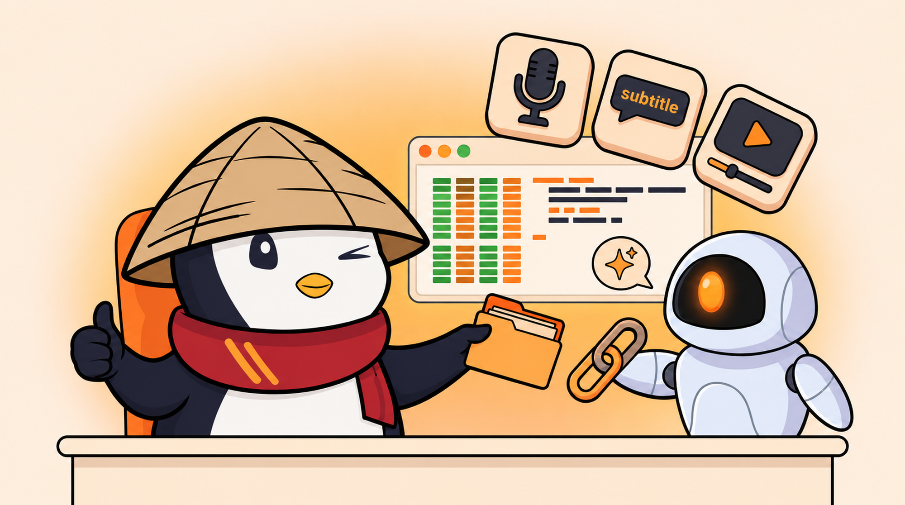
</p>

エージェントがどこで動いているかによって、2 つの入り口があります。

**アプリ内：MCP サーバー。** Tools → AI → MCP server でオンにすると、OmniGet はブラウザ拡張機能と同じローカルブリッジ上で、インストールごとの同じトークンで保護された状態で、37 のツールを Model Context Protocol で公開します。エージェントは、URL をキューに追加してダウンロードパネルで監視、一時停止、再開、キャンセルしたり、PDF の結合、分割、レンダリング、テキスト抽出、サニタイズを行ったり、whisper.cpp でファイルを文字起こししたり、テキスト読み上げや OCR を実行したり、画像をリサイズしたり、重複を見つけたり、ファイルを検索したり、X の投稿、スレッド、プロフィール、検索、トレンドを読んだり、あなたのセッションで Instagram のプロフィールを調べたり、LLM の価格を比較したり、テキストを人間らしく書き換えたり、ディスクやキャッシュをスキャンしたり、スタートアップ項目やインストール済みのアプリを一覧表示したり、aria2 や gallery-dl で大きなファイルやギャラリーを取得したりできます。ページには Claude Code、Claude Desktop、Cursor、VS Code、Goose、Codex 向けの設定スニペットが表示されるので、セットアップは貼り付けるだけです。*beta*

**Claude Code 内：`omniget` プラグイン。** [`claude-plugin/`](claude-plugin/omniget) フォルダーには、デスクトップアプリをまったく必要としない [Claude Code](https://claude.com/claude-code) 向けのプラグインが含まれています。動画、音声、SNS の投稿の URL をリクエストと一緒に貼り付けると、`omniget-fetch` と `omniget-transcribe` のスキルが自動的に起動します。明示的に指定したいときは、スラッシュコマンドも使えます：

```
/plugin marketplace add /path/to/omniget/claude-plugin
/plugin install omniget
/omniget:setup                       # installs yt-dlp, ffmpeg and omniget-cli after one confirmation
/omniget:fetch <url> [--audio]       # the media file, to ~/Downloads/omniget
/omniget:transcribe <url|file>       # captions, then local whisper.cpp, then Gemini or OpenAI if you added a key
/omniget:research <url>              # caption plus transcript distilled into a Markdown note with [mm:ss] references
/omniget:doctor                      # what is installed, what is missing, how to add it
```

セットアップでは、お使いの OS 向けのビルド済みの `omniget-cli` がダウンロードされ、スキルが OmniGet のネイティブの Instagram、X、Bilibili、Threads のエクストラクターを使えるようになります。ログインの壁で失敗したダウンロードは、`OMNIGET_COOKIES_FROM_BROWSER` で指定したブラウザの Cookie を使って一度だけリトライされます。API キーはご自身のターミナルから `~/.config/ai-keys.env` に保存され、表示されることはありません。

---

## プラグイン: Courses、Telegram、Convert

コアプラグインはアプリケーションのバイナリに直接組み込まれているため、実行時のダウンロードや ABI の互換性エラーが起きません。Marketplace ページでは、有効なプラグインと、各プラグインに許可されている操作（イベント、通知、設定、ダウンロードフォルダー、プロキシ、管理対象のツール、ダウンロードキュー）が表示され、設定やオン・オフの切り替えができます。

<p align="center">
  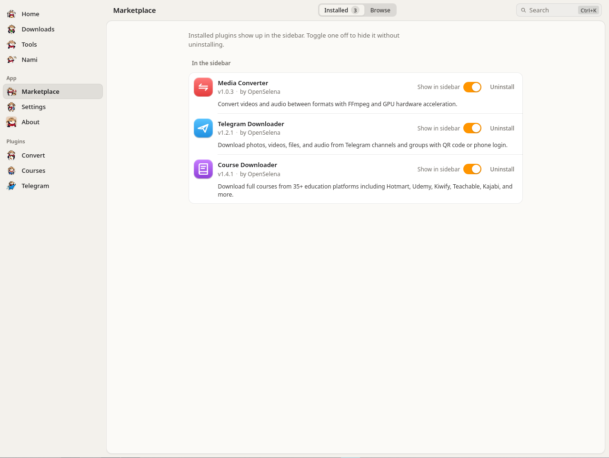
</p>

###  Courses

組み込みの Courses プラグインは、**Hotmart**、**Udemy**、**Kiwify**、**Rocketseat**、**Coursera**、**Domestika**、**Skillshare**、**Alura**、**Ebac** を含む 38 の学習プラットフォームに対応しています。アプリ内の Web ビューからログインするか、拡張機能で保存した Cookie を使うか、利用可能な場合はアカウントの認証情報でログインします。OmniGet は購入済みの講座を一覧表示し、講座のアウトラインを開いて必要なセクションを選べるようにし（DRM で保護された講義はスキップされ、報告されます）、レッスンと添付ファイルを、必要に応じて通し番号を付けてダウンロードします。

###  Telegram

QR コードまたは電話番号でログインします。参加しているすべてのチャンネルとグループを閲覧し、写真、動画、ドキュメント、音声で絞り込み、ファイルを検索し、個別のメディアやチャットのアーカイブ全体を、進捗リスト付きでダウンロードできます。メディアのダウンロードは、サニタイズされたフォルダー名で `{download_dir}/OmniGram/{channel_name}/` に整理されます。

###  Convert

マシンが対応していれば GPU アクセラレーションを使って FFmpeg で変換します：動画と音声のコンテナ、コーデック、解像度、ビットレート、圧縮を変更でき、インターネット接続は不要です。

---

## その他の機能

- 任意のページ、設定、ツールにジャンプできるコマンドパレット（**Ctrl+K** または **Cmd+K**）。
- コピーしたリンクを検出し、トーストからワンクリックでダウンロードを提案するクリップボード検出。
- 拡張機能で取得するか `cookies.txt` からインポートしたセッションをサイトごとに保持し、ドメインごとにテストボタンを備えた Cookie マネージャー。
- 動画の要約：**Settings → AI** に URL を貼り付けると、OmniGet が字幕を取得し、指定した長さと言語で要約します。
- ファイルの送信：ファイルを選んで単語コードを共有すると、相手が自分の OmniGet にそのコードを貼り付けて受け取ります。
- 聴いているもの、見ているもの、読んでいるものを表示する Discord Rich Presence。ダウンロードは非公開のままです。
- トレイアイコン、システム起動時の起動、最小化状態での起動、ダウンロード中のスリープ防止。
- すべてのダウンロードが、実行した yt-dlp コマンドをそのまま保持します。開いてフラグを編集し、リトライできます。
- Catppuccin（4 つのフレーバー）、Dracula、One Dark Pro、3 種類の e-ink、3 種類の Nyxvamp を含む 14 のテーマ。
- 12 の言語：英語、ポルトガル語、スペイン語、フランス語、イタリア語、ギリシャ語、ロシア語、日本語、ペルシャ語、ラオ語、簡体字中国語、繁体字中国語。
- Windows、macOS（Apple Silicon と Intel）、Linux（x86_64 と ARM64）で動作します。

---

## プライバシーと OmniGet がしないこと

<p align="center">
  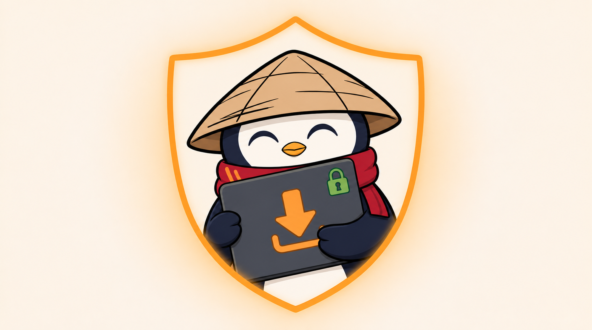
</p>

すべてはあなたのコンピューター上で動作します。アカウントはなく、間に私たちのサーバーが入ることもなく、何をダウンロードしたかについてのテレメトリーもありません。Cookie と API キーはローカルのプロフィールに保存されます。OmniGet が自ら行うネットワーク通信は、ダウンロードを依頼したサイト、アップデートとプラグインのための GitHub、そして AI ツールを使うときに設定した AI プロバイダーへの通信だけです。

OmniGet がダウンロードするのは、あなた自身のログインセッションですでに開けるものだけです。DRM の回避、ペイウォールの突破、認証情報の共有は行わず、DRM で保護された講義はスキップされ、報告されます。著作権と各プラットフォームの利用規約を守る責任は利用者にあります。全文はアプリ内の **About → Terms and ethics** にあります。

---

## コード署名ポリシー

Windows での無料のコード署名は [SignPath.io](https://about.signpath.io) が提供し、証明書は [SignPath Foundation](https://signpath.org) によるものです。

コードの変更と署名付きのリリースは、OpenSelena のメンテナーがレビューし、承認しています。OmniGet がデータをどのように扱うかについては、[プライバシーと OmniGet がしないこと](#プライバシーと-omniget-がしないこと) と [プライバシーに関するドキュメント](https://omniget.nav.bd/docs/#privacy) をご覧ください。

---

## よくある質問

**OmniGet は無料ですか？**
はい。GPL-3.0 で、有料プランも広告もアカウントもありません。

**OmniGet は yt-dlp の GUI ですか？**
一部はそうです。yt-dlp が数多くのサイトへの対応を担い、OmniGet はそれを同梱し、検証し、更新します。その上に、講座、Instagram、X、Pinterest、Bilibili、Telegram、トレント向けのネイティブのエクストラクター、再開とリトライに対応したキュー、ツールセクション、メディア変換があります。

**購入した Udemy や Hotmart の講座をダウンロードできますか？**
はい。Courses プラグインはアプリに直接組み込まれています。アプリからログインし、講座とセクションを選んでダウンロードしてください。レッスンと添付ファイルは講座ごとに整理されたフォルダーに保存されます。Hotmart、Udemy、Kiwify、Rocketseat、Coursera、Domestika など、38 のプラットフォームに対応しています。

**Instagram のストーリーズ、親しい友達、ハイライトをダウンロードできますか？**
はい。ブラウザ拡張機能で取得したあなた自身のセッションを使います。ストーリーズは既読にならずにダウンロードされます。

**X の動画、スレッド全体、プロフィールのすべてのメディアをダウンロードできますか？**
はい。公開されている投稿にはログインは不要です。ブックマークとあなた自身のフォローのリストには、あなたの X セッションが必要です。

**Pinterest のボードをオリジナルの画質でバックアップできますか？**
はい。動画、セクション、Cookie を使ったシークレットボードにも対応しており、差分同期で新しいものだけを取得できます。

**中断したダウンロードは再開できますか？**
はい。途中までのファイルは保持されて続きから再開され、レート制限に達するとバックオフ付きでリトライします。

**どの形式で保存できますか？**
動画は MP4、MKV、WebM。音声は MP3、M4A、Opus、FLAC、WAV。字幕は SRT、VTT、ASS で、埋め込みまたはファイルの横に保存できます。

**Python、Node、ターミナルは必要ですか？**
いいえ。アプリをダウンロードして開き、リンクを貼り付けるだけです。ターミナルが必要なのは、上記の macOS の Gatekeeper への一度きりの対処だけです。

**macOS でアプリが壊れていると表示されます。**
[初回起動のセクション](#初回起動時の警告とその解除方法) にある 2 つのコマンドを実行してください。アプリが公証されていないために起きるもので、一度だけ起こります。

**Reddit、LinkedIn、Spotify、X、Instagram のデータエクスポートを読み込めますか？**
はい。プラットフォームにエクスポートをリクエストし、対応するツールで zip を開いてください。解析はあなたのマシン上で行われ、何もアップロードされません。

**AI エージェントは OmniGet を使えますか？**
はい、2 つの方法があります。Tools → AI の MCP サーバーは、Claude Code、Claude Desktop、Cursor、VS Code、Goose、Codex に 37 のツールを公開します。また、`claude-plugin/` フォルダーには、デスクトップアプリなしでメディアの取得と文字起こしを行う Claude Code プラグインが含まれています。[AI エージェント向けの OmniGet](#ai-エージェント向けの-omniget-mcp-サーバーと-claude-code-プラグイン) をご覧ください。

**動画をオフラインで字幕に文字起こしできますか？**
はい。Tools → Speech and subtitles → Transcribe は、ローカルで whisper.cpp を使います。モデルは必要に応じてダウンロードされます。

**USB メモリから実行できますか？**
はい。Windows であれば、実行ファイルの隣に `portable.txt` ファイルを置くことで実行できます。

**Linux ではどのパッケージを選べばよいですか？**
Debian と Ubuntu は `.deb`、Fedora、openSUSE、RHEL 系は `.rpm`、それ以外は `.AppImage` です。x86_64 版と ARM64 版の両方が公開されています。OmniGet は Flathub にはありません。

---

## コマンドライン

`omniget-cli` は、Windows、macOS（Intel と Apple Silicon）、Linux 向けのすべてのリリースに含まれています。[最新のリリース](https://github.com/OpenSelena/omniget/releases/latest) から `omniget-cli-<version>-<target>` を入手してください。

```bash
omniget info <url>                     # title, formats and size, downloads nothing
omniget download <url> -q 1080 -o ~/Videos
omniget download <url> --audio-only --subs en,pt
omniget batch links.txt -m 3           # one URL per line, 3 at a time
omniget import-cookies cookies.txt     # Netscape format
```

---

## ソースからのビルド

OmniGet を使いたいだけであれば、[リリースを入手してください](#ダウンロードとインストール)。ビルドするには、[Rust](https://rustup.rs/)（プラグインの ABI が依存しているため、正確なツールチェーンが `rust-toolchain.toml` で固定されています）、[Node.js](https://nodejs.org/) 18 以上、[pnpm](https://pnpm.io/) が必要です。

```bash
git clone https://github.com/OpenSelena/omniget.git
cd omniget
pnpm install
pnpm tauri dev
```

<details>
<summary>Linux でのビルドに必要な依存関係</summary>

```bash
sudo apt-get install -y libwebkit2gtk-4.1-dev build-essential curl wget file libxdo-dev libssl-dev \
  libayatana-appindicator3-dev librsvg2-dev patchelf libasound2-dev libpipewire-0.3-dev clang libclang-dev
```

</details>

本番ビルド：

```bash
pnpm tauri build --config '{"bundle":{"createUpdaterArtifacts":false}}'
```

リリースでは、メンテナーだけが持つ秘密鍵でアップデーター用の成果物に署名しているため、単純な `pnpm tauri build` は「A public key has been found, but no private key」というエラーで止まります。上記のフラグはローカルビルドでそれらの成果物を無効にするもので、それ以外は何も変わりません。

`courses`、`telegram`、`convert` の各プラグインは `src-tauri/plugins/` の中にあり、メインのバイナリにコンパイルされます。プラグインのレジストリは [omniget-plugins](https://github.com/OpenSelena/omniget-plugins) です。

技術スタック：Tauri 2、Rust、Svelte 5 を使った SvelteKit、SQLite、yt-dlp、FFmpeg、トレント用の librqbit、whisper.cpp、aria2、gallery-dl。

---

## コントリビュートと翻訳

バグ報告とプルリクエストは [Issues](https://github.com/OpenSelena/omniget/issues) と [Pull requests](https://github.com/OpenSelena/omniget/pulls) にお願いします。質問やちょっとしたヘルプは [Telegram](https://t.me/OpenSelena) で受け付けています。セキュリティに関する問い合わせや脆弱性の報告：[SECURITY.md](SECURITY.md) または [igect@vk.com](mailto:igect@vk.com)。

翻訳は [Weblate](https://hosted.weblate.org/engage/omniget-openselena/) で管理しています。言語を選んで、ブラウザ上で翻訳してください。新しい文字列は、`main` に取り込まれてから数時間後にそこに表示されます。

OmniGet は、[yt-dlp](https://github.com/yt-dlp/yt-dlp)、[FFmpeg](https://ffmpeg.org/)、[gallery-dl](https://github.com/mikf/gallery-dl)、[whisper.cpp](https://github.com/ggerganov/whisper.cpp)、[aria2](https://aria2.github.io/)、[SponsorBlock](https://sponsor.ajay.app/)、[Return YouTube Dislike](https://returnyoutubedislike.com/)、[FxTwitter](https://github.com/FixTweet/FxTwitter)、[Spicetify](https://spicetify.app/)、[cat-catch](https://github.com/xifangczy/cat-catch)（拡張機能のメディアスニッファーの一部）、[Tauri](https://tauri.app/) の上に作られています。これらをメンテナンスしているすべての方に感謝します。

ペンギンのマスコットは OmniGet の公式マスコットです。ファンアートは大歓迎です。プロジェクトのブランドアセットを許可なく商用利用したり、誤解を招くサードパーティのフォークに同梱したりすることはできません。

<p align="center">
  <a href="https://star-history.com/#OpenSelena/omniget&Date"></a>
</p>

<p align="center">
  <a href="https://github.com/OpenSelena/omniget/releases/latest"><b>OmniGet をダウンロード</b></a> · <a href="LICENSE">GPL-3.0</a>
</p>
